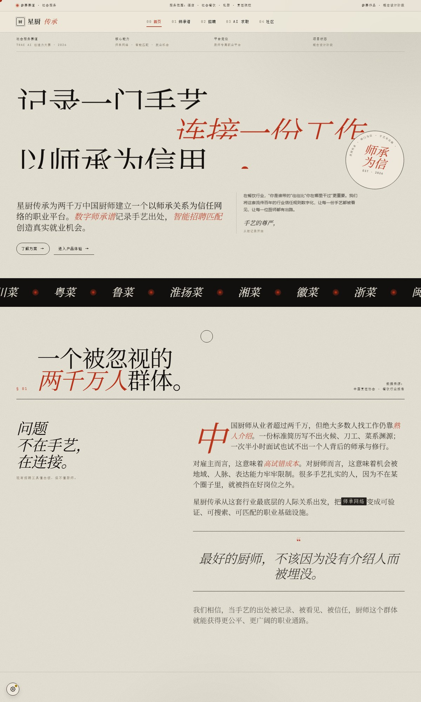

# 星厨传承 · Star Chef

> 以「师承关系」为信任底层的厨师职业平台



## 这是什么

中国有超过两千万厨师，但绝大多数人找工作仍靠熟人介绍，技能与师承难以被验证和定价。**星厨传承**把厨师行业最底层的人际关系 —— 师承 —— 数字化，做成可记录、可搜索、可匹配的职业基础设施：

- **数字师承谱**：以古籍宗谱的形式记录每位厨师的师承代际，左栏选门派、中栏看谱系、右栏读个人档案；
- **智能就业匹配**：基于师承、菜系、地域、薪资做厨师与雇主双向推荐；
- **AI 求职助手**：用大白话描述经历，AI 自动生成规范求职档案，帮不会写字的老师傅也能用；
- **厨艺社区**：菜品与经验分享，构建同行信任。

## 本地运行

主作品是**单个 HTML 文件**，纯静态、零依赖、零构建，浏览器直接打开即可：

```bash
# 方式一：直接双击打开
星厨传承.html

# 方式二：起一个静态服务（推荐，避免个别浏览器的本地文件限制）
npx http-server . -p 8848
# 打开 http://127.0.0.1:8848/星厨传承.html
```

AI 相关功能需要 DeepSeek API Key：在页面中按提示输入即可，**Key 只存在页面内存里，不写入任何文件，也不进仓库**。

## 项目结构

```
星厨传承.html            # 主作品：单文件交付（内嵌全部 CSS / HTML / JS / 演示数据）
CLAUDE.md                # 开发说明：架构约定、硬约束、数据管线
lineage_demo/            # 师承谱交互方案 demo（A–D7），直接打开
miniprogram/             # 微信小程序版（原生小程序，微信开发者工具导入）
docs/                    # README 配图
data/                    # 真实厨师数据源与合并产物
scripts/                 # 爬虫、数据合并、demo/小程序构建脚本
```

## 真实厨师数据管线

`data/` 与 `scripts/` 是一条独立演进的真实数据管线，供 demo 与小程序使用：

```
爬虫脚本（scripts/*crawler*.js、list-crawler.js 等）
  → data/ 下各来源 JSON（cyxh-* / cuisine-* / cswzg-* / bfs-* / manual-adds.json …）
  → node data/_merge.js          # 唯一合并入口：去重、菜系统一、师承关系注入
  → data/chefs-merged.json       # 合并产物：schools + chefs + lineage
  → node scripts/build-pinyin-index.js   # 姓名拼音搜索索引
  → data/_slim-pinyin.json
  → node scripts/build-d5.js / build-d6-search.js / build-d7-card-size.js
  → lineage_demo/demo-D5 ~ D7.html
```

真实人物的师承、籍贯等信息坚持**可溯源**原则，宁缺毋滥。

## 微信小程序版

`miniprogram/` 是基于同一套数据与视觉语言的微信小程序实现（默认 `touristappid` 游客 AppID）：

1. 用「微信开发者工具」导入 `miniprogram/` 目录；
2. 数据由 `scripts/build-mp-data.js` / `build-mp-mock.js` 从 `data/chefs-merged.json` 生成；
3. 修改数据请改生成器后重新生成，不要手改产物。

## 视觉与技术

- 单文件交付：全部 CSS / HTML / JS / 数据内联在 `星厨传承.html`，无构建工具、无包管理；
- 视觉语言：Fraunces 衬线 + Noto Serif SC，复古纸纹色板（纸白 / 墨黑 / 朱砂 / 苔绿 / 金），报刊版式 + 钢印元素；
- 交互：5 个视图（首页 / 师承谱 / 招聘 / AI 求职 / 社区）由原生 JS 的 ViewCtrl 切换；
- AI：调用 DeepSeek Chat API（流式），4 处场景各有独立 prompt。

## 说明

- 本项目为参赛作品，未附加开源许可证；
- 页面中的厨师姓名、职位等演示数据仅用于产品形态展示，真实人物数据来自公开可溯源信息；
- 开发约定与数据管线细节见 [CLAUDE.md](CLAUDE.md)。
