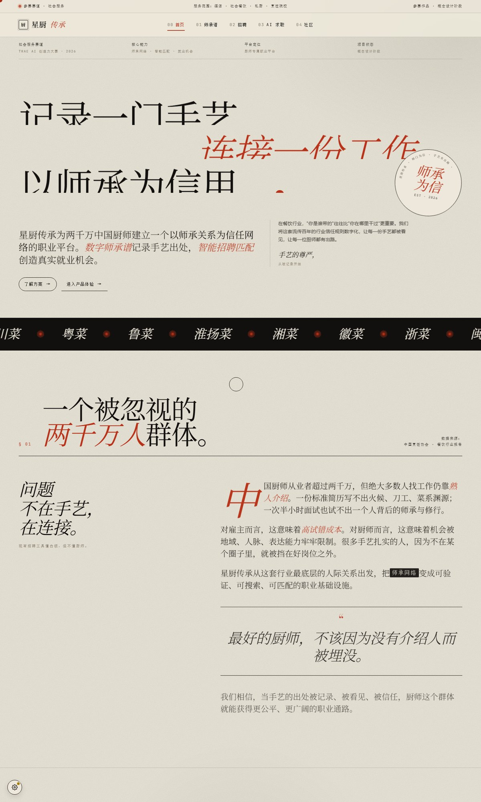

# 星厨传承 · Star Chef

> 以「师承关系」为信任底层的厨师职业平台



参赛项目：**第二十届全国大学生软件创新大赛**（区域赛初赛阶段）。本轮主交付物为 `web/` React 工程；单文件 `星厨传承.html` 降为附属 / 参考实现。

## 这是什么

中国有超过两千万厨师，但绝大多数人找工作仍靠熟人介绍，技能与师承难以被验证和定价。**星厨传承**把厨师行业最底层的人际关系 —— 师承 —— 数字化，做成可记录、可搜索、可匹配的职业基础设施：

- **数字师承谱**：以古籍宗谱的形式记录每位厨师的师承代际，左栏选门派、中栏看谱系、右栏读个人档案；
- **智能就业匹配**：基于师承、菜系、地域、薪资做厨师与雇主双向推荐；
- **AI 求职助手**：用大白话描述经历，AI 自动生成规范求职档案，帮不会写字的老师傅也能用；
- **厨艺社区**：菜品与经验分享，构建同行信任。

## 本地运行

### 主交付：`web/`

Vite + React + TypeScript 工程，运行时通过 `fetch('/data/chefs.json')` 加载数据（静态文件位于 `web/public/data/chefs.json`）。

```bash
cd web
npm install
npm run dev        # 默认 http://localhost:5173
```

| 脚本 | 作用 |
| --- | --- |
| `npm run dev` | 启动 Vite 开发服务器（含 `/api/deepseek` 代理） |
| `npm run build` | `tsc -b && vite build`，产物 `web/dist/` |
| `npm run lint` | `oxlint` 静态检查 |
| `npm run preview` | 本地预览构建产物 |

`web/.gitignore` 已忽略 `dist/`、`node_modules/`、`screenshots/`。

AI 相关功能需要自备 DeepSeek API Key：

- Key **持久化在浏览器 `localStorage`**（web 端键 `star-chef:deepseek-key`，模式键 `star-chef:deepseek-mode`），仅存本机、不上传服务器、不进入仓库；清除需在浏览器清理该站点数据。
- `/api/deepseek` 代理**仅 `npm run dev` 生效**（`vite.config.ts` 的 `server.proxy`）。构建产物 / `preview` / 静态部署下没有该代理，如需真实调用请在页面切换到直连 `https://api.deepseek.com` 模式（`web/src/lib/ai.ts`），直连受浏览器 CORS 限制；也可不配 Key，走本地规则演示。

### 附属 / 参考：单文件 `星厨传承.html`

纯静态、零依赖、零构建，浏览器直接打开：

```bash
# 方式一：双击打开
星厨传承.html

# 方式二：起静态服务（避免个别浏览器本地文件限制）
npx http-server . -p 8848
# 打开 http://127.0.0.1:8848/星厨传承.html
```

单文件版本的 DeepSeek Key 同样写入浏览器 `localStorage`（键 `xc_deepseek_key`，见 `星厨传承.html` 约 2275 / 2278 行），页面自述「仅存于本机 localStorage，不上传任何服务器」；不写入仓库文件。无 Key 时自动降级为本地演示模式。

## 项目结构

```
web/                     # 主交付：Vite 8 + React 19 + TS 的 React 工程
  src/                   # 页面 / 组件 / lib（lib/ai.ts、useData.ts 等）
  public/data/           # chefs.json 等运行时静态数据
  vite.config.ts         # /api/deepseek dev proxy
  package.json           # dev / build / lint / preview
星厨传承.html            # 附属/参考：单文件实现（内嵌 CSS/HTML/JS 与演示 mock 数据）
参赛材料/                # 本轮新建：区域初赛提交与自查材料（见「参赛材料」）
  项目计划书_草稿.md
  匿名自查报告.md
  视频/                  # 演示视频制作文档 + 2 条内部预览 MP4（均非提交件）+ 各自说明
data/                    # 真实厨师数据来源 JSON + 合并产物
scripts/                 # 爬虫、清洗、合并、各端构建脚本
miniprogram/             # 附属：微信原生小程序（按团队口径已从手机端展示范围下线）
lineage_demo/            # 静态师承谱交互原型（A–D7；D5–D7 为脚本生成的大体积产物）
demos/                   # 视觉方案静态 HTML（demo1–4 + index）
docs/                    # README 配图
CLAUDE.md                # 历史开发约定（单文件时代，部分表述待同步）
...                      # 根目录另有爬虫网页快照 *.html、extract*.js、交付差距分析清单 xlsx 等，均非作品代码
```

## 真实厨师数据管线

`data/` + `scripts/` 是独立演进的真实数据管线，`web/` 是当前主消费端，另供小程序与 `lineage_demo/` 使用：

```
爬虫 / 清洗脚本（scripts/cyxh-*、cswzg-*、list-crawler.js、cuisine-* 等）
  → data/ 下各来源 JSON
  → node data/_merge.js                 # 唯一合并入口：去重、菜系统一、师承注入
  → data/chefs-merged.json              # 1537 chefs / 9 schools
  → node scripts/build-pinyin-index.js  # 实读 data/_slim.json → 姓名拼音索引
  → data/_slim-pinyin.json
  → 下游三端：
      web/public/data/chefs.json        # 主消费端：1415 条（1238 真实 + 177 derived），meta.total=1238，8 门派 / 43 菜系
      miniprogram/data/*.js             # 由 build-mp-data.js / build-mp-mock.js 生成
      lineage_demo/demo-D5 ~ D7.html   # 由 build-d5/d6/d7 生成，1.5–1.7 MB 内嵌数据
```

两处需按源码更正的旧描述：

- `chefs-merged.json` **没有顶层 `lineage` 字段**，顶层为 `generatedAt / source / cuisineNormalized / schools / chefs / stats`；师承关系散落在 `chefs[].master / masters / masterIds` 等字段中。
- `scripts/build-pinyin-index.js` 实际读 `data/_slim.json`（而非 `chefs-merged.json`）生成 `_slim-pinyin.json`，与「合并产物直出索引」的旧描述不一致，口径待统一（待核实）。

真实人物的师承、籍贯等信息坚持**可溯源**原则，宁缺毋滥；改数据请改来源 JSON 或 `_merge.js` 后重跑，不要手改产物。

## 数据口径提示

**三套数据口径并存，切勿认为各端数据一致**：

| 端 | 数据 | 性质 |
| --- | --- | --- |
| 单文件 `星厨传承.html` | 约 96 厨师 / 32 岗位 / 18 帖 | 页面内嵌演示 mock |
| `miniprogram/` | 1537 真实 + 96 mock | 真实数据与演示 mock 混用 |
| `web/`（主交付） | 1415 条 = 1238 真实 + 177 derived，`meta.total=1238`，8 门派 / 43 菜系 | 由真实数据派生 |

## 视觉与技术

| | `web/`（主交付） | `星厨传承.html`（附属） |
| --- | --- | --- |
| 技术栈 | Vite 8 + React 19 + TypeScript ~7 + react-router-dom 7 + GSAP 3 | 原生 HTML/CSS/JS，无构建、无包管理 |
| 路由 / 视图 | `BrowserRouter`，6 个业务路由（首页 / 师承谱 / 厨师详情 / 招聘 / AI 求职 / 社区） | 5 个视图由原生 `ViewCtrl` 切换 |
| 数据 | 运行时 `fetch('/data/chefs.json')` | 内嵌 `DATA` 常量 |
| AI | DeepSeek 流式，`lib/ai.ts` 统一封装；proxy / 直连两种模式 | DeepSeek 流式，4 处场景独立 prompt，无 Key 时本地 mock 降级 |
| 响应式 | 12 档 `@media` 断点（520–1100px）+ 汉堡菜单 | 单文件版式 |

视觉语言沿用 Fraunces 衬线 + Noto Serif SC、复古纸纹色板（纸白 / 墨黑 / 朱砂 / 苔绿 / 金）、报刊版式 + 钢印元素。

## 微信小程序版（附属 / 待裁剪）

`miniprogram/` 是微信原生小程序（5 页 + custom tabBar），`project.config.json` 使用 `touristappid` 游客 AppID，`services/ai.js` 为本地规则 mock、无网络请求；数据由 `scripts/build-mp-data.js` / `build-mp-mock.js` 从 `data/chefs-merged.json` 生成，不要手改产物。

按团队口径（A1，仅把展示设备限定为 Android 设备浏览器），小程序**已从手机端展示范围下线**，属附属 / 待裁剪形态。官方「须基于 Android 平台开发」的理解**仍待组委会书面答疑（Q-06 待确认）**，本 README 不将其写成官方结论。

## 参赛材料

本轮新建的 `参赛材料/` 面向**第二十届全国大学生软件创新大赛**区域赛初赛。赛事主题「软件定义世界，创新引领未来」，不允许自选题，采用四个指定赛题（AI 赋能学习生产力 / AI 融入日常 / AI+影像 / AI+健康）；**本作品对应的赛题归属（Q-11）待团队确认，README 不预先指定**。

| 文件 | 定性 |
| --- | --- |
| `项目计划书_草稿.md` | 按附件 7 三段结构（项目概述 / 技术方案 / 项目计划）起草，含多处 `[待团队填写]` 占位、《待填清单》《依据索引》《评分项呼应对照》；**初赛唯一必交件是《项目计划书》**，本件为草稿、待定稿 |
| `匿名自查报告.md` | 匿名合规自查 |
| `视频/` | 演示视频制作文档（分镜 / 口播 / 素材核验 / 渲染验收等）+ `预览片说明.md` + `星厨传承_真实素材预览_非提交件.mp4`（约 19.7s 内部预览，**非提交件**） |

定性说明：3–5 分钟 MP4 属**团队自定的可选演示规格（P3）**，不是本届必交件；网盘链接、文件大小、作品名字数等限制均非本 README 认定的官方要求。

## 已知限制与待办

| 项 | 状态 |
| --- | --- |
| `data/_merge.js:4` 等多个脚本硬编码旧路径 `D:/Study/AI_Space/play-CC/star_chef/data`，换机需改路径 | 待修 |
| `scripts/build-pinyin-index.js` 实读 `_slim.json` 而非 `chefs-merged.json`，与管线文档口径不一致 | 待核实 / 待统一 |
| 三套数据口径并存（见上），各端数量与门派数不同 | 待统一 |
| `web/src/index.css:53-63` 仍有 `width:1126px` 定宽 Vite 模板残留；但已有 12 档断点 + 汉堡菜单，响应式可用 | 待清理 |
| `/api/deepseek` dev proxy 仅 `npm run dev` 生效；构建 / 预览 / 静态部署需直连模式（受 CORS 限制） | 已知限制 |
| `web/` 与单文件版均无测试框架 | 待补 |
| Q-06：Android 平台口径待组委会书面答疑 | 待确认 |
| Q-11：赛题归属待团队确认 | 待确认 |
| `CLAUDE.md` 为单文件时代的历史约定，部分表述（交付形态、Key 存储方式、数据管线口径）沿用旧口径，与本 README 不一致 | 待同步 |

## 说明

- 本项目为参赛作品，未附加开源许可证；
- 仓库提交作者为匿名占位（`Star Chef Dev <user@local>`），未包含实名信息；
- 页面中的厨师姓名、职位等演示数据仅用于产品形态展示，真实人物数据来自公开可溯源信息；
- 历史开发约定见 [CLAUDE.md](CLAUDE.md)，交付形态与数据口径以本 README 和 `web/` 源码为准。
